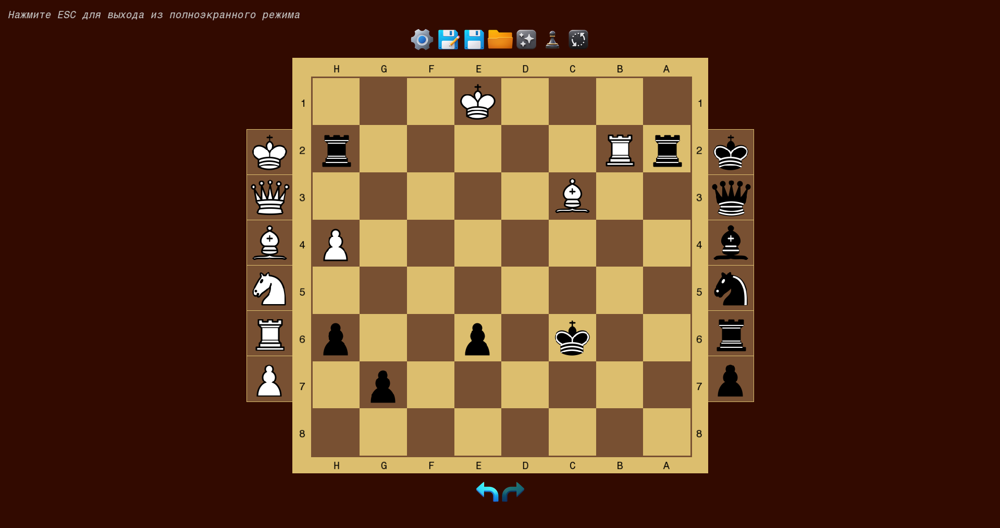

# Chess-position (Шахматная позиция)

Сверхлегкая цифровая шахматная доска без логики и ограничений правил. Создана специально для разбора позиций, решения задач и проведения занятий в шахматных кружках и секциях.

> ⚠️ **Примечание автора:** Это мой самый первый учебный проект. Код местами наивный и далек от идеала, но программа полностью рабочая, проверенная на практике и отлично справляется со своей задачей!

---
## 📸 Скриншоты интерфейса

*Интерфейс приложения с возможностью свободной расстановки фигур.*
---

### 🌟 Основные возможности
* **Свободная расстановка:** Помещайте любые фигуры на любые клетки без ограничений шахматного движка (можно поставить хоть 5 королей).
* **Сенсорный и мышиный ввод:** Удобный адаптивный интерфейс как для ПК, так и для интерактивных досок/планшетов.
* **Сохранение и загрузка:** Возможность сохранять любые позиции в файл и открывать их во время занятий.
* **История ходов:** Полноценная поддержка отмены и повтора действий (Undo / Redo).
* **Удобные утилиты:** Сброс доски в начальную позицию и быстрый переворот доски.

---

### 📥 Как скачать и запустить
Скачать готовый установщик для Windows можно в разделе **[Releases](../../releases)**. 
Просто запустите скачанный файл и следуйте инструкциям установки.

---

### Сборка проекта
Для сборки проекта потребуется подключить библиотеку SFML (версия 2.6.0).

---

### 💬 Обратная связь
Если приложение оказалось вам полезным или у вас есть идеи по улучшению — буду рад вашим отзывам в разделе Issues!
